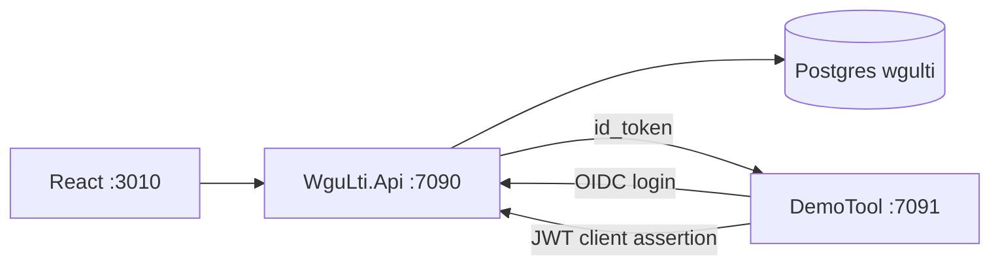

# WguLti

WguLti is an LTI 1.3 / LTI Advantage **platform**: the LMS side that registers third-party tools and launches them. It is not an LTI tool. The tool in `tools/WguLti.DemoTool` exists only so you can try a launch locally.

Phase 1 signs `LtiResourceLinkRequest` launches, publishes a JWKS document, accepts OAuth2 `client_credentials` assertions, and stores tool registrations. Assignment and Grade Services, NRPS, Deep Linking, Dynamic Registration, and the Platform Notification Service are routed and return 501 until their phases. The design, including the launch sequence, is in [docs/design.md](docs/design.md). The database scripts in `db/` are the schema source of truth.



## Prerequisites

- .NET SDK 8
- Node.js 20 or newer (the client is Vite + React + TypeScript)
- PostgreSQL 18 with the `citext` extension and `psql` 16+
- A trusted local HTTPS dev certificate: `dotnet dev-certs https --trust`

Nothing in this repo is an AWS deployment, a production key, or a database password.

## Database

From `db/`, against the local server on port 5432. Pick a dev password and keep it out of git.

```bash
export PGHOST=localhost PGPORT=5432
psql -U postgres -d postgres -v ON_ERROR_STOP=1 -v app_password='CHANGE-ME-dev' -f db/000_create_database.sql
psql -U postgres -d wgulti -v ON_ERROR_STOP=1 --single-transaction -f db/V001__baseline.sql
psql -U postgres -d wgulti -v ON_ERROR_STOP=1 --single-transaction -f db/V002__seed_reference.sql

export PGPASSWORD='CHANGE-ME-dev'
psql -U wgulti_app -d wgulti -v ON_ERROR_STOP=1 -f db/tests/smoke.sql
psql -U wgulti_app -d wgulti -v ON_ERROR_STOP=1 -f db/tests/permissions.sql
unset PGPASSWORD
```

`000_create_database.sql` is safe to re-run; re-running rotates the app password. Details, RDS notes, and Flyway/DbUp settings are in [db/README.md](db/README.md).

## Configuration

The API and the worker share a user-secrets id. Set the connection string there, or export `ConnectionStrings__Lti`. Do not put the password in `appsettings.json`.

```bash
dotnet user-secrets set "ConnectionStrings:Lti" \
  "Host=localhost;Port=5432;Database=wgulti;Username=wgulti_app;Password=CHANGE-ME-dev;Search Path=lti" \
  --project src/WguLti.Api
```

The same command with `--project src/WguLti.Worker` uses the same secret store.

Development defaults (`appsettings.Development.json`):

- `Lti:Issuer` and `Lti:PublicBaseUrl` are `https://localhost:7090`
- `Lti:DevAdminEnabled` is true, so the admin API does not require a key
- `Lti:SeedDemoData` is true. On startup the API inserts tenant `wgu`, account WGU, user Ada Lovelace, and course C950 when the database is up and V002 has been applied
- `Lti:AllowLoopbackToolUrls` is true so the API may fetch `https://localhost` JWKS documents
- `Lti:Signing:Provider` is `File`. The first run writes an RSA PEM key to `~/.wgulti/dev-signing-key.pem` (mode 0600). Override with `Lti:Signing:KeyPath`. Set `Provider` to `Kms` only when Phase 6 is implemented; that provider refuses to sign today

Outside Development, set `Lti:AdminApiKey` in user-secrets. Admin calls then need `Authorization: Bearer <key>`.

## Run

Three processes. Ports are fixed so they stay clear of other local apps.

```bash
dotnet run --project src/WguLti.Api
dotnet run --project src/WguLti.Worker
dotnet run --project tools/WguLti.DemoTool

cd client
npm install
npm run dev
```

| Process | URL |
|---|---|
| API | https://localhost:7090 (Swagger at `/swagger` in Development) |
| API health | http://localhost:5090/health |
| Client | http://localhost:3010 |
| Demo tool | https://localhost:7091 |

The Vite dev server proxies `/api` and `/.well-known` to https://localhost:7090 and ignores the dev-certificate name mismatch. The browser still has to trust the certificate for the launch iframe, which navigates to the API and the DemoTool directly.

### Register the DemoTool and launch

1. Open https://localhost:7091 and copy the OIDC login URL, redirect URI, and public JWK (or use the JWKS URL).
2. Open http://localhost:3010, create a registration with those values, and copy the generated client id.
3. `dotnet user-secrets set "DemoTool:ClientId" "<client id>" --project tools/WguLti.DemoTool` and restart the DemoTool.
4. On Deployments, install the registration into C950.
5. On Course, choose Ada Lovelace and Launch. The frame posts the OIDC login to the tool, the tool redirects back to `/api/lti/authorize`, and the platform form-posts a signed `id_token`.
6. On the tool page, request a client-credentials token. Grant the registration the `score` scope first or the token endpoint returns `invalid_scope`, which still shows the assertion was checked.

## Tests

```bash
dotnet build WguLti.sln
dotnet test WguLti.sln
cd client && npm run build
```

`dotnet test` does not need Postgres. API tests use a throwaway signing key and a connection string that is never opened. The Playwright project is skipped until an end-to-end run is wired. Database checks are the SQL scripts under `db/tests/` and the `database` job in `.github/workflows/ci.yml` (Postgres 18 service, then smoke, permissions, and read-only).

## Projects

| Project | Responsibility |
|---|---|
| `WguLti.Domain` | Claim URIs, scopes, privacy levels, persistence types |
| `WguLti.Core` | `IdTokenBuilder`, `AuthRequestValidator`, `ClientAssertionValidator`, `LaunchService`, `TokenService`, registration and deployment services |
| `WguLti.Infrastructure` | EF Core + Npgsql mapped onto schema `lti` (no migrations), file signing key, tool JWKS fetch, demo seed, outbox / purge / partitions |
| `WguLti.Api` | HTTP surface |
| `WguLti.Worker` | `outbox_jobs` retry, `lti.purge_expired()`, `lti.ensure_audit_partitions(3)` |
| `client` | Registrations, deployments, course launch placeholder |
| `tools/WguLti.DemoTool` | Login initiation, `id_token` check, sample token request |

## What is implemented

- JWKS at `/.well-known/jwks.json` and `/api/lti/security/jwks`, plus OpenID platform configuration
- Third-party login initiation and the OIDC authorize endpoint, with signed `LtiResourceLinkRequest` tokens
- Client-assertion token endpoint and down-scoping
- Tool registration, deployment, and placement APIs, and the admin/course UI
- Worker loops for the outbox, purge, and audit partitions

Deep Linking, AGS, NRPS, Dynamic Registration, key rotation, and PNS notice delivery return 501 with the phase that owns them. See the roadmap in the design doc.
