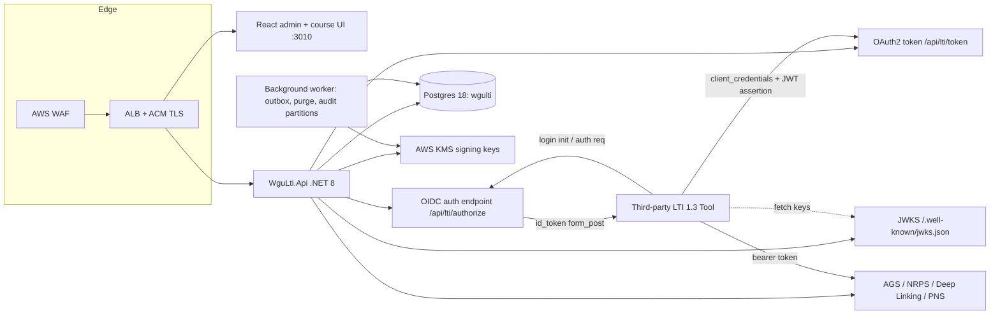
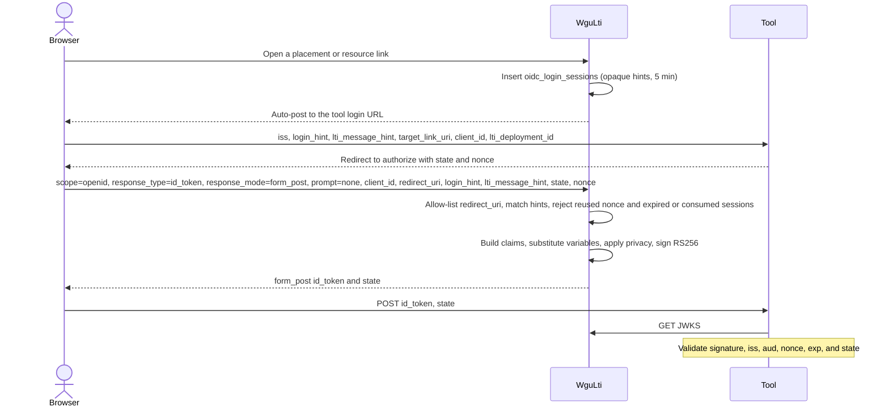

# WguLti: an LTI 1.3 platform

WguLti is the LMS side of LTI 1.3 / LTI Advantage. It registers third-party tools, launches them with a signed `id_token`, and will host the Advantage services those tools call back. It is a platform, not a tool. The tool keeps its own content; WguLti owns users, courses, rosters, and the gradebook.

In scope: LTI Core 1.3, Security Framework 1.0, and (on the roadmap) Deep Linking 2.0, Assignment and Grade Services 2.0, Names and Role Provisioning Services 2.0, Dynamic Registration 1.0, and later Platform Notification Service 1.0. LTI 1.1 launches are out of scope. The `lti1p1` claim can still carry legacy identifiers when a migration map exists.

The Canvas model is the design stance: one registration (`client_id`) per tool, many deployments of that registration at an account or a course, placements that decide where the tool appears, a privacy level per tool, and signing keys that overlap (next, active, and retiring published together).

## Roles

| Concern | Platform (WguLti) | Tool (third party) |
|---|---|---|
| Who starts a launch | Sends the third-party-initiated login | Answers with an OIDC authentication request |
| Identity | OIDC provider. Issues a signed `id_token` | Relying party. Validates it against the platform JWKS |
| Keys | Publishes JWKS. Signs launches and, later, notices | Publishes JWKS. Signs client assertions and Deep Linking responses |
| Services | Token endpoint, AGS, NRPS, Deep Linking return, PNS | Calls them with scoped bearer tokens |
| Data | Users, courses, rosters, gradebook | Its own content and activity |

## Architecture

One ASP.NET Core API behind the load balancer. A worker process runs housekeeping on the same host or its own small group. State lives in Postgres, so API instances stay stateless and the load balancer does not need sticky sessions.



AWS WAF, ALB, and KMS are the production shape. This repository does not deploy them. Locally, signing uses an RSA key file outside the repo. `IPlatformKeySource` is the seam: `File` in development, `Kms` reserved for Phase 6 (the KMS implementation throws until it is wired).

## Repository layout

```
WguLti.sln
src/WguLti.Domain            entities, claim and role constants
src/WguLti.Core              launch, id_token, token, substitution
src/WguLti.Infrastructure    EF Core on schema lti, no EF migrations
src/WguLti.Api               ASP.NET Core minimal APIs
src/WguLti.Worker            outbox, purge_expired, audit partitions
client/                      React + Vite admin and course shell
tools/WguLti.DemoTool        tiny LTI 1.3 tool for local launches
tests/WguLti.Core.Tests      xUnit
tests/WguLti.Api.Tests       WebApplicationFactory
tests/WguLti.E2E             Playwright placeholder
db/                          SQL source of truth
docs/design.md
```

Entity Framework maps the tables the process reads and writes. It never creates or migrates the schema. `db/V001__baseline.sql` does that.

## Local ports

| Service | Port |
|---|---|
| WguLti.Api HTTPS | 7090 |
| WguLti.Api HTTP, `/health` only | 5090 |
| React client | 3010 |
| DemoTool | 7091 |
| Postgres 18, database `wgulti` | 5432 |

HTTPS matters locally: iframe launches and `SameSite=None` cookies need it. The HTTP port refuses everything except `/health`.

## Tool registration

An admin creates one registration per tool. The platform generates a numeric `client_id`. A deployment installs that registration at exactly one account or one course and gets its own `deployment_id` (max 255 characters).

| Field | Who supplies it | Notes |
|---|---|---|
| `client_id` | Platform | Opaque, unique, shown to the admin to give the tool |
| `deployment_id` | Platform, per install | One registration can have many |
| OIDC login initiation URL | Tool | Must be `https://` |
| Redirect URIs | Tool | Exact-match allow list |
| Target link URI | Tool | Default launch URL |
| JWKS URL or public JWK | Tool | Verifies client assertions. At least one is required |
| Placements | Admin | `course_navigation`, `link_selection`, `ai_assistant`, and the rest of the Canvas set |
| Custom parameters | Admin or tool | Keys match `[a-z0-9_]+`. Values may use `$Variable` substitution |
| Scopes | Admin | Only granted scopes can be issued |
| Privacy level | Admin | `anonymous` (default), `name_only`, `email_only`, `public` |

Manual create turns the registration **on**. Dynamic Registration (Phase 5) will create it **off** until an admin reviews scopes.

Account deployments are inherited by courses under that account through `accounts.path`. Course deployments apply to one context. The `deployment_id` claim tells the tool which install launched.

### Dynamic Registration (Phase 5, stubbed)

1. Admin pastes the tool registration URL. The platform stores a one-time `registration_token` and opens the URL with `openid_configuration` and `registration_token`.
2. The tool reads `GET /.well-known/openid-configuration`, including `https://purl.imsglobal.org/spec/lti-platform-configuration`.
3. The tool `POST`s `/api/lti/register` with the bearer token, redirect URIs, login URL, JWKS, scopes, and `https://purl.imsglobal.org/spec/lti-tool-configuration`.
4. The platform returns `client_id` and consumes the token. State stays `off`.
5. The tool posts `{subject:'org.imsglobal.lti.close'}`. The admin enables the tool and deploys it.

## Launch flow



`POST /api/lti/launches` is what the course UI calls. It returns the login URL and fields; the browser posts them. `GET` or `POST /api/lti/authorize` is the OIDC endpoint the tool redirects to.

Validation order:

- Unknown `client_id`, disabled registration, or a `redirect_uri` that is not an exact allow-list match: OIDC error JSON. The platform does not post to an untrusted URI.
- After the redirect is trusted: missing `state` or `nonce`, wrong `response_type` / `response_mode` / `prompt`, a mismatched `login_hint` or `lti_message_hint`, an expired or already-consumed session, or a reused nonce. Those errors are form-posted back to `redirect_uri` with `error` and `state`.
- Nonces are stored in `used_nonces` (`purpose = auth_request`). The login session is consumed once.

Phase 1 signs `LtiResourceLinkRequest` only. Other message types return 501.

### Claims

| Claim | Required | Source |
|---|---|---|
| `iss`, `aud`, `azp`, `sub`, `nonce`, `iat`, `exp` | Yes. `sub` is the opaque per-tool id | `tenants.issuer`, `client_id`, `lti_user_ids.sub`, the auth request. Lifetime 5 minutes |
| `message_type` | Yes | `LtiResourceLinkRequest` |
| `version` | Yes | `1.3.0` |
| `deployment_id` | Yes | `deployments.deployment_id` |
| `target_link_uri` | Yes | The value sent at login initiation |
| `resource_link` | Yes for this message | `resource_links` or a stable placement id |
| `roles` | Yes, may be empty | Enrollment role to LIS v2 URI |
| `context` | When a course is in the launch | Opaque id, label, title, course type |
| `tool_platform` | Included | `platform_guid`, name, `product_family_code` `wgulti` |
| `launch_presentation` | When known | Placement window target, locale |
| `custom` | When parameters exist | Merged registration, then placement, then deployment, then resource link, then substituted |
| `lis` | Only when privacy is `public` | `person_sourcedid` |
| `name`, `email` | Per privacy level | `name_only` and above release the name. `email_only` and `public` also release email |
| AGS and NRPS endpoint claims | When those scopes are granted | URLs scoped to the context |

`aud` and `azp` are the tool `client_id`. The header is `alg=RS256` plus `kid`.

### Variable substitution

Substitution is a pure function. Unknown variables, and variables the privacy level does not allow, are left as written.

| Variable | Resolves to | Gate |
|---|---|---|
| `$User.id` | Platform user id | `name_only` or higher |
| `$Person.name.full` | Display name | `name_only` or higher |
| `$Person.email.primary` | Email | `email_only` or `public` |
| `$Context.id`, `$Context.title` | Course | Always |
| `$CourseSection.sourcedId` | Section SIS id | `public` |
| `$ResourceLink.id`, `$ResourceLink.available.endDateTime` | Link | Always |
| `$Wgu.program.code`, `$Wgu.term` | WGU extensions | Registration `claims_allowed` |

`$Name` and `${Name}` are both recognized.

## Token endpoint

```
POST /api/lti/token
Content-Type: application/x-www-form-urlencoded

grant_type=client_credentials
&client_assertion_type=urn:ietf:params:oauth:client-assertion-type:jwt-bearer
&client_assertion=<JWT>
&scope=https://purl.imsglobal.org/spec/lti-ags/scope/score
```

The assertion is RS256. `iss` and `sub` must both be the `client_id`. `aud` must be this token endpoint. `jti` is required and is stored in `used_nonces` (`purpose = client_assertion_jti`) so it cannot be replayed. `exp` more than five minutes ahead is rejected. Clock skew is 60 seconds.

The access token is opaque. Only its SHA-256 is stored. `expires_in` is 3600 seconds. The returned `scope` is the intersection of what the tool asked for and what the registration grants. Errors follow RFC 6749 (`invalid_client`, `invalid_grant`, `invalid_scope`, `invalid_request`). The route is rate limited.

Tool keys come from `public_jwk` when it is stored, otherwise from `jwks_uri`. Fetches are HTTPS only, size-capped, and blocked from private addresses unless `Lti:AllowLoopbackToolUrls` is true (development default, so `https://localhost:7091` works).

## Advantage services (stubbed)

These routes exist and return HTTP 501 with the phase that will implement them.

### AGS 2.0 (Phase 3)

| Method and route | Scope | Behavior |
|---|---|---|
| `GET /api/lti/courses/{ctx}/line_items` | lineitem or lineitem.readonly | Filter and page the container |
| `POST /api/lti/courses/{ctx}/line_items` | lineitem | Create a gradebook column |
| `GET/PUT/DELETE .../line_items/{id}` | lineitem | Only items this deployment created |
| `POST .../line_items/{id}/scores` | score | Append to `scores`. A trigger updates `results` when the tool timestamp is newer |
| `GET .../line_items/{id}/results` | result.readonly | Current result per user |

Score flow, already enforced in SQL: `scores` is append-only. `apply_score` upserts `results` only for a newer timestamp, scaled to the line item maximum. `sync_result_to_submission` updates the primary line item's gradebook cell. `instructor_override` and `excused` rows are left alone. Grade changes append to `grade_changes`.

### NRPS 2.0 (Phase 4)

`GET /api/lti/courses/{ctx}/names_and_roles` with scope `contextmembership.readonly`. Members use the per-tool `sub`, LIS role URIs, and names or email only when the privacy level allows. Differences come from `enrollment_changes`.

### Deep Linking 2.0 (Phase 2)

Same OIDC launch with `LtiDeepLinkingRequest`. The tool posts `JWT` to `/api/lti/deep_linking/return`. The platform checks the tool signature, the echoed `data`, `accept_types`, and `accept_multiple`, then creates resource links and module items.

### PNS 1.0 (Phase 7)

`GET/PUT /api/lti/deployments/{id}/notice_handlers`. The worker posts signed notice batches from `outbox_jobs` with retry. The worker already locks and retries jobs; it does not yet deliver a notice.

## Data model

Database `wgulti`, schema `lti`, PostgreSQL 18, owner `wgulti_owner`. The scripts in `db/` are the source of truth for local Postgres and for RDS. See `db/README.md` for the exact `psql` commands. Do not edit an applied `V###` file; add `V003__...sql`.

| File | Run as | What it does |
|---|---|---|
| `000_create_database.sql` | Superuser locally, RDS master in AWS | Roles `wgulti_owner` (no login), `wgulti_app` (login, DML), `wgulti_readonly`, and database `wgulti`. Password from `-v app_password` |
| `V001__baseline.sql` | Admin, `SET ROLE wgulti_owner` | Tables, FKs, checks, indexes, triggers, grade sync, audit partitions, grants |
| `V002__seed_reference.sql` | Admin | 39 LIS roles, 23 permissions, 6 built-in roles. No users and no secrets |
| `tests/` | `wgulti_app` / `wgulti_readonly` | Smoke chain, denied-privilege checks, read-only checks |

| Domain | Tables |
|---|---|
| Tenancy | `tenants`, `accounts` (ancestor `path`) |
| Authentication | `identity_providers`, `users`, `user_logins`, `user_sessions`, `api_tokens` |
| Roles | `lis_roles`, `permissions`, `roles`, `role_permissions`, `account_users` |
| Courses | `contexts`, `course_sections`, `enrollments`, `enrollment_changes` |
| Groups | `group_categories`, `groups`, `group_memberships` |
| Content | `assignment_groups`, `assignments`, `modules`, `module_items` |
| Keys | `platform_keys` (next / active / retiring / revoked, one active per tenant) |
| Tool config | `tool_registrations`, `tool_jwks_cache`, `registration_messages`, `placements`, `custom_params` |
| Installs | `deployments`, `context_placement_overrides` |
| LTI identity | `lti_user_ids`, `lti1p1_consumers`, `lti1p1_id_map` |
| Links | `deep_link_requests`, `content_items`, `resource_links` |
| Launch | `oidc_login_sessions`, `used_nonces`, `access_tokens` |
| Gradebook | `line_items`, `scores`, `results`, `submissions`, `grade_changes` |
| Ops | `dynamic_registrations`, `notice_handlers`, `outbox_jobs`, `audit_log`, `schema_migrations` |

`wgulti_app` can DML and can call `purge_expired()` and `ensure_audit_partitions()`. It cannot DDL, and it cannot update or delete `audit_log`, `scores`, `grade_changes`, or `enrollment_changes`. `wgulti_readonly` cannot read credential or session tables.

The connection string is `ConnectionStrings:Lti` from user-secrets or the environment. It is never committed.

```
Host=localhost;Port=5432;Database=wgulti;Username=wgulti_app;Password=<dev>;Search Path=lti
```

In Development the API seeds a tenant `wgu`, account `WGU`, user Ada Lovelace (`ada@wgu.example`), and course C950 Data Structures II when `Lti:SeedDemoData` is true and V002 has been applied. That seed is application data, not a change to the SQL scripts.

## Endpoints

| Route | Phase 1 |
|---|---|
| `GET /health` | Live. HTTP 5090 serves only this |
| `GET /.well-known/jwks.json` and `GET /api/lti/security/jwks` | Live. Active public RSA key |
| `GET /.well-known/openid-configuration` | Live. Issuer, authorize, token, JWKS, registration URL, platform configuration |
| `POST /api/lti/launches` | Live. Returns the login-initiation form fields |
| `GET` or `POST /api/lti/authorize` | Live. Validates and form-posts `id_token` |
| `POST /api/lti/token` | Live. `client_credentials` plus JWT assertion |
| `POST/GET/PUT/DELETE /api/admin/registrations` | Live. Soft-delete sets `state=deleted` |
| `/api/admin/deployments`, `/api/admin/placements`, `GET /api/admin/overview` | Live |
| `POST /api/lti/deep_linking/return` | 501, Phase 2 |
| AGS line item, score, and result routes | 501, Phase 3 |
| `GET /api/lti/courses/{ctx}/names_and_roles` | 501, Phase 4 |
| `POST /api/lti/register`, `POST /api/admin/dynamic_registrations` | 501, Phase 5 |
| `POST /api/admin/keys/rotate` | 501, Phase 6 |
| `GET/PUT /api/lti/deployments/{id}/notice_handlers` | 501, Phase 7 |

Admin routes are open when `Lti:DevAdminEnabled` is true (Development only). Otherwise they require `Authorization: Bearer` matching `Lti:AdminApiKey` from user-secrets.

## Security

| Area | Control |
|---|---|
| Signing | RS256 with `kid`. Dev private key is a PEM file under the user profile (`~/.wgulti`), mode 0600, never committed. Production private keys stay in KMS |
| Key rotation | Monthly in production: publish `next`, promote to `active`, keep `retiring` until issued tokens and tool caches expire. JWKS `Cache-Control` max-age is one hour by default |
| Replay | Auth nonce, client-assertion `jti`, and later Deep Linking nonces in `used_nonces`. Login session consumed once |
| Clock | 60 second skew. `id_token` 5 minutes. Access token 1 hour. Assertion `exp` must not be more than 5 minutes ahead |
| Session binding | `login_hint` is opaque and stored on the login session. A mismatch is `login_required` |
| Iframes | Course UI posts the login form into a named frame. CSP `frame-ancestors` and platform storage postMessage are later work |
| PII | Privacy level gates name, email, picture, and SIS id. Anonymous is the default. `sub` is always an opaque per-tool id |
| Least privilege | Scopes are granted per registration and down-scoped at the token endpoint |
| Rate limiting | Fixed window on `/api/lti/token`, HTTP 429 with `Retry-After` |
| Outbound | Tool JWKS fetches are HTTPS, size-capped, and blocked from private IPs unless loopback is explicitly allowed |
| Errors | RFC 6749 at the token endpoint. OIDC errors at authorize. Problem details on the 501 stubs |
| Audit | Launches and token issuance append to `audit_log`. The worker calls `ensure_audit_partitions(3)` and `purge_expired()` |

No production secrets, cloud credentials, or KMS keys are in this repository.

## Testing and certification

Unit tests cover `id_token` claim building (including a sign and JWKS-style verify round trip), authorize nonce and state handling, and client-assertion validation (audience, `sub`, signature, expiry, `jti` replay, and the five-minute `exp` cap). API tests hit JWKS, OpenID configuration, the token and authorize failure paths, and the 501 stubs without a database.

Later: Testcontainers against `db/V001` and `db/V002`, Playwright through DemoTool, saLTIre, and the 1EdTech LTI Advantage platform suite. The E2E project is present and skipped until that stack is wired.

## Roadmap

| Phase | Deliverable | Exit test |
|---|---|---|
| 0. Foundations | Repo, `wgulti`, tenants, users, contexts, JWKS | JWKS is served. Dev key file works |
| 1. MVP launch | Manual registration, deployments, OIDC launch, token endpoint | A DemoTool resource-link launch validates |
| 2. Deep Linking | Request, response, resource link creation | DemoTool inserts a module item |
| 3. AGS | Line items, scores, results, gradebook | A posted score appears on the submission |
| 4. NRPS | Memberships, paging, differences | Roster honors privacy level |
| 5. Dynamic Registration | Registration endpoint and review UI | A tool registers with no hand-typed fields |
| 6. Certification | KMS signing, hardening, 1EdTech suite | LTI Advantage platform certification |
| 7. Extras | PNS, Asset Processor, platform storage | An AI feedback processor runs on a submission |

An assistant can ship later as just another tool: an `ai_assistant` or `course_navigation` placement, NRPS for the instructor view, AGS for practice scores, and Deep Linking for practice sets. It should see only what its privacy level and scopes allow.

## Specifications

- [LTI Core 1.3](https://www.imsglobal.org/spec/lti/v1p3)
- [LTI 1.3 implementation guide](https://www.imsglobal.org/spec/lti/v1p3/impl)
- [Security Framework 1.0](https://www.imsglobal.org/spec/security/v1p0/)
- [Deep Linking 2.0](https://www.imsglobal.org/spec/lti-dl/v2p0)
- [Assignment and Grade Services 2.0](https://www.imsglobal.org/spec/lti-ags/v2p0)
- [Names and Role Provisioning Services 2.0](https://www.imsglobal.org/spec/lti-nrps/v2p0)
- [Dynamic Registration 1.0](https://www.imsglobal.org/spec/lti-dr/v1p0)
- [Platform Notification Service 1.0](https://www.imsglobal.org/spec/lti-pns/v1p0/main)
- [Canvas: configuring an LTI Advantage tool](https://canvas.instructure.com/doc/api/file.lti_dev_key_config.html)
- [saLTIre](https://saltire.lti.app/)
